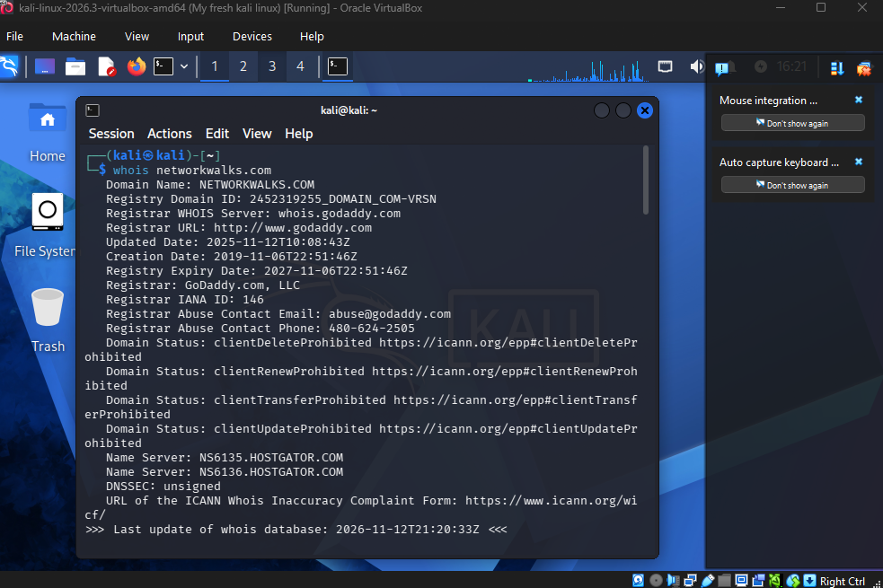
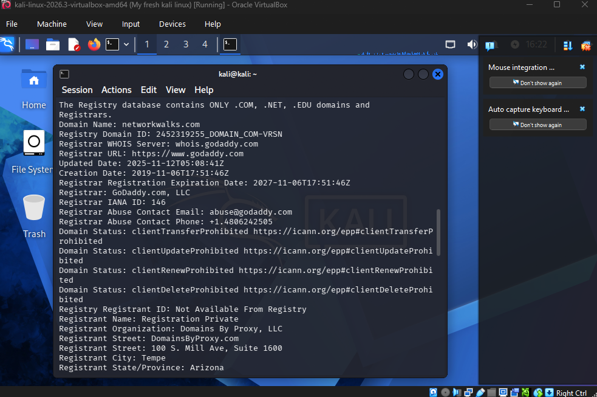
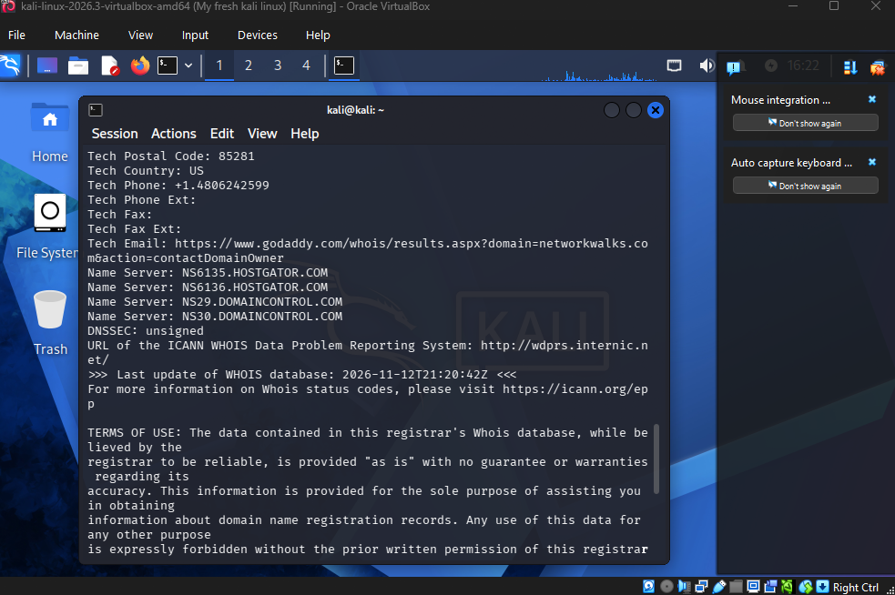
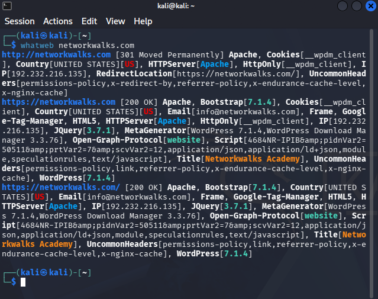
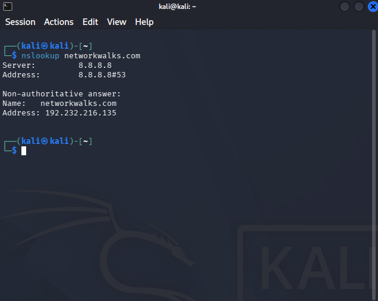
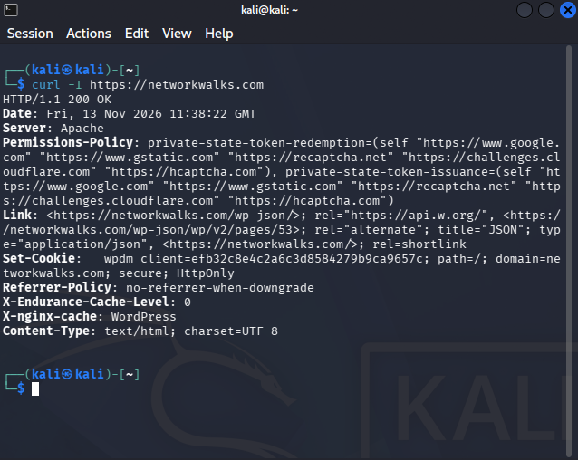
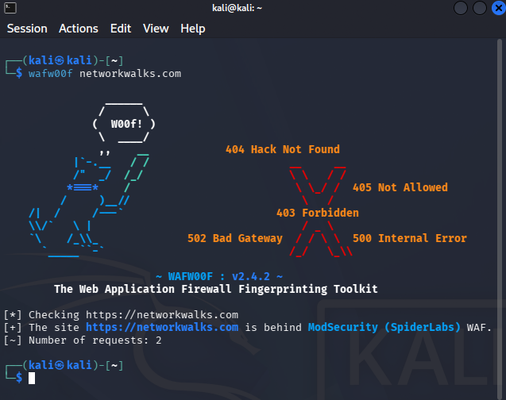
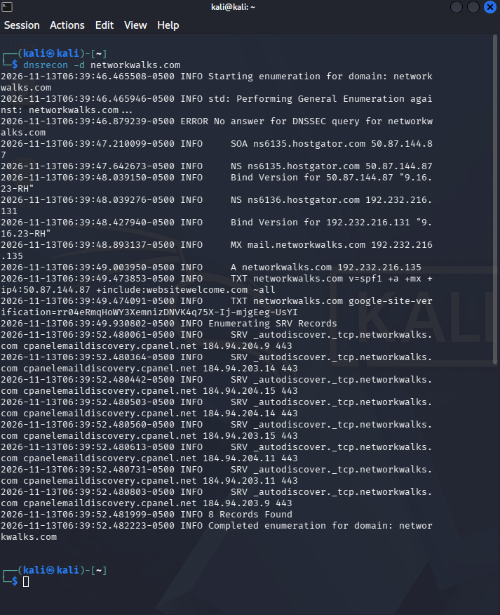
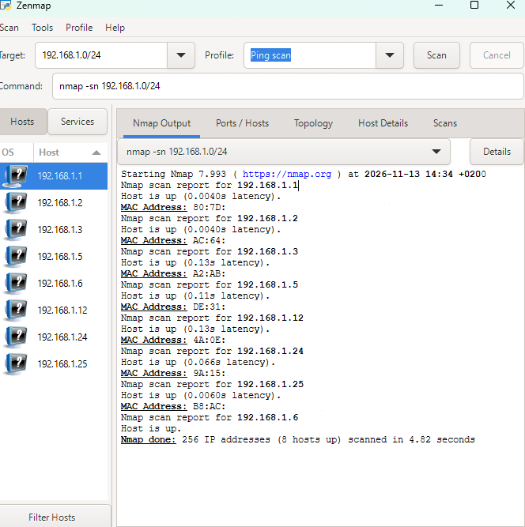
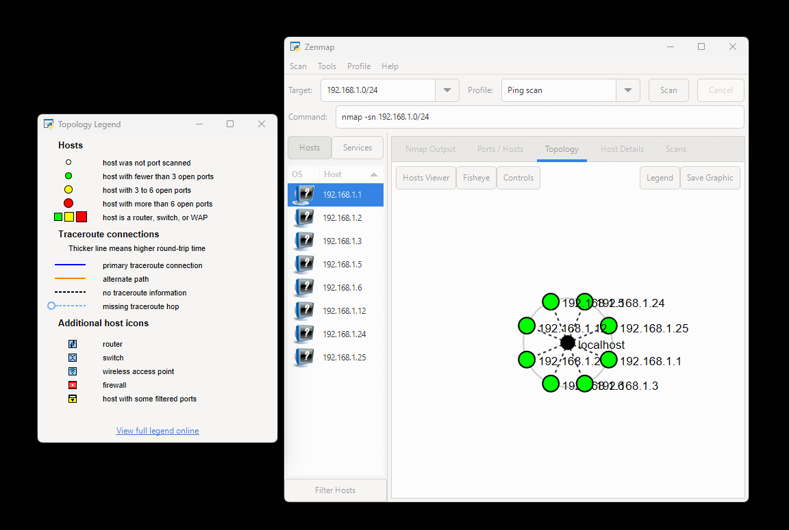

 <div align="center">

# 🔐 Footprinting, Reconnaissance & Network Scanning

**Practical domain reconnaissance, information gathering, and local network discovery using cybersecurity tools**

</div>

<p align="center">
  
  
  
  
  
  
  
  
  
</p>

---

## 📌 Project Overview

This project focuses on **Footprinting, Reconnaissance, and Network Scanning**, as part of the Cybersecurity Program at NetworkWalks (Batch B084).

The practical exercises explore how cybersecurity professionals collect information about a target, investigate domain and DNS information, identify website technologies, analyze HTTP responses, detect Web Application Firewall (WAF) technologies, and discover active devices within a local network.

The project combines several reconnaissance techniques and network discovery tools to demonstrate how information gathering contributes to the early stages of a penetration-testing assessment.

---

## 🎯 Objectives

The main objectives of this project are to:

- Understand the fundamentals of footprinting and reconnaissance.
- Gather domain registration information using WHOIS.
- Identify website technologies using WhatWeb.
- Investigate DNS resolution using Nslookup.
- Analyze HTTP response headers using cURL.
- Identify Web Application Firewall technologies using Wafw00f.
- Enumerate DNS records using DNSRecon.
- Discover live hosts on a local network using Zenmap (Nmap GUI).
- Identify local IP addresses, network subnets, and MAC addresses.
- Generate and document a network topology.
- Understand the importance of authorized reconnaissance and network scanning.

---

## 🛠️ Tools & Technologies

| 🔧 Tool | 🎯 Purpose |
|---|---|
| WHOIS | Retrieve domain registration and ownership-related information. |
| WhatWeb | Identify technologies and frameworks used by websites. |
| Nslookup | Investigate DNS resolution and query DNS records. |
| cURL | Retrieve HTTP responses and inspect response headers. |
| Wafw00f | Detect and identify Web Application Firewall technologies. |
| DNSRecon | Perform DNS enumeration and gather DNS-related information. |
| Nmap | Discover hosts and investigate network services. |
| Zenmap | Graphical interface for running and analyzing Nmap scans. |
| Kali Linux | Linux environment for cybersecurity tools and practical exercises. |

---

## 🎯 Project Scope

The project covers two main areas:

### 1. Domain Footprinting & Reconnaissance

Collecting information about domains and websites through different information-gathering techniques.

Activities include:

- Domain registration information gathering.
- Website technology fingerprinting.
- DNS investigation and resolution.
- HTTP response-header analysis.
- Web Application Firewall detection.
- DNS record enumeration.

### 2. Local Network Discovery

Investigating devices connected to a local network and documenting the network environment.

Activities include:

- Identifying local network interfaces.
- Determining IP addresses and subnet information.
- Discovering live hosts.
- Identifying MAC addresses.
- Generating a network topology.

---

# 🪜 Practical Exercises

## Step 1. Domain Footprinting Using WHOIS

WHOIS was used to retrieve publicly available domain registration information.

The exercise demonstrates how domain-related information can help build an initial understanding of a target.

**Command:**

```bash
whois <target-domain>
```

Information that can be investigated includes:

- Domain registrar.
- Registration and expiration dates.
- Domain name servers.
- Registration status.
- Available registrant information.

---

## Step 2. Website Technology Identification Using WhatWeb

WhatWeb was used to identify technologies and components associated with a website.

This helps understand the technologies exposed by a target website during the reconnaissance phase.

**Command:**

```bash
whatweb <target-domain>
```

Examples of information WhatWeb may identify:

- Web server technologies.
- Content Management Systems (CMS).
- JavaScript libraries.
- Frameworks.
- Website-related technologies.

---

## Step 3. DNS Investigation Using Nslookup

Nslookup was used to investigate DNS resolution and retrieve information about domain names.

**Command:**

```bash
nslookup <target-domain>
```

This exercise helps demonstrate:

- Domain name resolution.
- DNS server responses.
- Resolved IP addresses.
- The relationship between domain names and IP addresses.

---

## Step 4. HTTP Header Analysis Using cURL

cURL was used to send HTTP requests and inspect the response headers returned by a web server.

**Command:**

```bash
curl -I https://<target-domain>
```

The response headers can provide useful information, including:

- HTTP status codes.
- Web server information, when exposed.
- Content types.
- Redirect information.
- Security-related headers.

Analyzing HTTP headers helps understand how a web server responds to client requests.

---

## Step 5. Web Application Firewall Detection Using Wafw00f

Wafw00f was used to investigate whether a website is protected by a Web Application Firewall (WAF).

**Command:**

```bash
wafw00f https://<target-domain>
```

The tool analyzes website responses to identify known WAF technologies when detectable.

Understanding the presence of a WAF is useful during the reconnaissance phase because it provides additional information about the target's web security infrastructure.

---

## Step 6. DNS Enumeration Using DNSRecon

DNSRecon was used to enumerate DNS information and investigate available DNS records.

**Command:**

```bash
dnsrecon -d <target-domain>
```

DNS enumeration helps investigate records such as:

- A records.
- AAAA records.
- MX records.
- NS records.
- TXT records.
- Other available DNS information.

This exercise demonstrates how DNS records can reveal information about a domain's infrastructure.

---

## Step 7. Local Network Discovery Using Zenmap

Zenmap, the graphical interface for Nmap, was installed and used to discover live hosts on the local network.

The purpose of this exercise was to understand how network discovery works and identify devices connected to the local network.

Activities included:

- Configuring a network discovery scan.
- Identifying active hosts.
- Reviewing discovered IP addresses.
- Examining available MAC address information.
- Understanding the devices present within the local network.

The scan was limited to the local network under my control.

---

## Step 8. Local Network Information Gathering

Network information was investigated to understand the structure of the local network.

The following information was identified:

| 🌐 Network Information | 🎯 Description |
|---|---|
| Local IP Address | IP address assigned to a local network interface. |
| Subnet Mask | Defines the network and host portions of an IP address. |
| Network Subnet | Identifies the local IP address range. |
| MAC Address | Hardware address associated with a network interface. |
| Active Hosts | Devices responding to network discovery. |

Understanding these elements is essential when analyzing network connectivity and documenting network infrastructure.

---

## Step 9. Network Topology Documentation

After completing the network discovery exercise, the collected information was used to generate and document a network topology.

The topology provides a visual representation of the discovered network environment, helping illustrate the relationship between network devices.

This documentation makes it easier to understand the network structure and communicate the results of the discovery process.

---

# 📸 Practical Evidence & Screenshots

The following screenshots document the practical exercises and tool usage completed during the project.

| Screenshot | Evidence |
|---|---|
|  | Screenshot 1 |
|  | Screenshot 2 |
|  | Screenshot 3 |
|  | Screenshot 4 |
|  | Screenshot 5 |
|  | Screenshot 6 |
|  | Screenshot 7 |
|  | Screenshot 8 |
|  | Screenshot 9 |
|  | Screenshot 10 |

---

# 💡 What I Learned

Through this project, I gained practical experience with several fundamental cybersecurity concepts.

### 1. Footprinting & Reconnaissance

I learned how cybersecurity professionals collect information about domains and websites before conducting further security assessments.

### 2. DNS Investigation

I developed a better understanding of DNS resolution, DNS records, and how domain names are associated with IP addresses.

### 3. Website Technology Fingerprinting

I learned how to use WhatWeb to identify technologies exposed by websites and understand the information that can be collected during reconnaissance.

### 4. HTTP Response Analysis

I gained experience inspecting HTTP response headers and understanding how web servers communicate with clients.

### 5. Web Application Firewall Detection

I learned how Wafw00f can help identify WAF technologies and how this information contributes to understanding a website's security infrastructure.

### 6. Network Scanning & Host Discovery

I gained practical experience using Zenmap to discover live hosts and investigate devices connected to a local network.

### 7. Network Fundamentals

I improved my understanding of IP addressing, subnet masks, MAC addresses, and network topology.

### 8. Documentation & Reporting

I learned the importance of documenting reconnaissance activities, collecting evidence, analyzing findings, and presenting security observations clearly.

---

# 🔐 Security & Ethical Considerations

All reconnaissance and scanning activities should be conducted responsibly and within an authorized scope.

- Only investigate domains and systems when you have permission or a legitimate basis to do so.
- Perform network scans only on networks you own or are explicitly authorized to assess.
- Avoid accessing, modifying, or disrupting systems without permission.
- Handle collected information responsibly.
- Follow applicable laws and security-testing guidelines.

**Important:** Reconnaissance and network scanning are legitimate cybersecurity techniques when performed within an authorized scope.

---

# 🔗 Tools & Resources

- **Kali Linux:** [https://www.kali.org/get-kali/](https://www.kali.org/get-kali/)
- **Nmap:** [https://nmap.org/](https://nmap.org/)
- **Zenmap:** [https://nmap.org/zenmap/](https://nmap.org/zenmap/)
- **WHOIS:** [https://who.is/](https://who.is/)
- **WhatWeb:** [https://github.com/urbanadventurer/WhatWeb](https://github.com/urbanadventurer/WhatWeb)
- **DNSRecon:** [https://github.com/darkoperator/dnsrecon](https://github.com/darkoperator/dnsrecon)
- **Wafw00f:** [https://github.com/EnableSecurity/wafw00f](https://github.com/EnableSecurity/wafw00f)
- **cURL:** [https://curl.se/](https://curl.se/)
